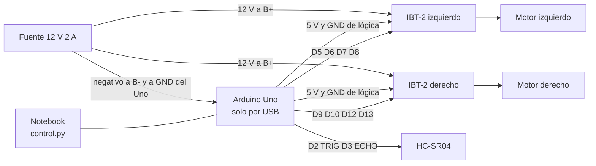

# Plataforma

Control remoto de una plataforma de dos motores. La notebook manda la dirección y la velocidad por USB. El Arduino Uno mueve los dos motores juntos y, si el sensor ve algo a 20 cm o menos, frena el avance y los giros. La marcha atrás sigue habilitada para esquivar.

Materia: Electrónica Digital, 2026, UNNOBA.

## Equipo

Alumnos:

- Acuña Matías Nahuel
- Gómez Dante Ismael
- Hernández Mateo Ezequiel
- Lucero Felipe Jorge
- Nervo Juanita

Docentes: Adrián Jaszczyszyn y Marcelo Guiguet.

## Qué hay en el repo

| Archivo | Rol |
| --- | --- |
| `plataforma/plataforma.ino` | Sketch que quedó cargado en el Arduino |
| `control.py` | Ventana de control en la notebook |
| `requirements.txt` | Dependencia de Python (`pyserial`) |
| `Informe.pdf` | Informe del trabajo |
| `Presentación.pdf` | Presentación del trabajo |

La ventana se llama **Control de la Plataforma**.

## Cómo usarlo

1. Cargar `plataforma/plataforma.ino` en el Arduino Uno (IDE o `arduino-cli`, placa `arduino:avr:uno`, 9600 baudios). En esta máquina el puerto fue **COM7**.
2. Cerrar el Serial Monitor. Un solo programa puede tener el puerto abierto. Si aparece `Acceso denegado`, el monitor o esta ventana ya lo están usando.
3. Instalar la dependencia y abrir el control:

```bash
pip install -r requirements.txt
python control.py
```

4. Pulsar **CONECTAR**. Al abrir el puerto el Uno se reinicia: el programa espera 2 segundos y después empieza a mandar comandos.
5. Mantener la flecha o el botón para mover. Soltar para parar. La barra de velocidad va de 0 a 100 y arranca en 100.

| Tecla | Movimiento |
| --- | --- |
| ↑ o W | Adelante |
| ↓ o S | Atrás |
| ← o A | Izquierda |
| → o D | Derecha |
| Espacio | Parar |

Si la ventana pierde el foco, la plataforma se detiene.

## Comportamiento

Los dos motores reciben la misma magnitud. Una rampa sube o baja de a 10 unidades de PWM cada 20 ms, con un tope de **150**. Ese tope existe porque la fuente es de **12 V y 2 A**: con los dos motores al máximo la fuente se cae y una rueda se apaga. El código no puede inventar corriente.

Antes de invertir el giro de un motor hay una pausa de 200 ms.

Si pasan más de 400 ms sin un comando nuevo, el Arduino para los motores.

El HC-SR04 mide cada 100 ms.

- Eco real a **20 cm o menos**: se bloquean adelante y los giros. Atrás sigue.
- Sin eco, o distancia mayor a 20 cm: el frente se toma como libre y se puede avanzar. El sensor, cuando no hay nada adelante, muchas veces no devuelve eco. Eso no es un obstáculo.

La ventana muestra la distancia en cm y la velocidad de acercamiento en cm/s (positiva cuando el objeto se acerca).

## Protocolo serial

9600 baudios, una línea por mensaje.

La notebook manda, cada 100 ms:

```text
F,100
B,80
L,60
R,60
S,0
```

`F` adelante, `B` atrás, `L` izquierda, `R` derecha, `S` parar. El número es el porcentaje 0–100. El Arduino lo mapea a PWM 0–150.

El Arduino responde:

```text
DIST,18.4,1
DIST,-1.0,0
```

El segundo campo es la distancia en cm. `-1.0` significa que no hubo eco. El tercero vale `1` solo cuando hay un eco real a 20 cm o menos.

## Conexiones

Hay dos drivers IBT-2 (BTS7960), uno por motor. Los motores no van en paralelo sobre un mismo driver. Cada uno es un motorreductor CIRCUSPLAY de 6 V o 12 V, usado a 12 V.



### Alimentación

| Qué | Dónde |
| --- | --- |
| Arduino | Solo USB de la notebook. No usar el plug de barril con la fuente de motores ni con el cargador de 20 V. |
| Lógica de los dos IBT-2 | `VCC` a 5 V del Arduino y `GND` a GND del Arduino. Puede ir por los rieles de la protoboard. Si el riel está cortado al medio, hace falta un puente. |
| Motores | 12 V de la fuente a **B+** de los dos drivers. Negativo de la fuente a **B−** de los dos drivers. |
| GND común | El negativo de la fuente (B−) se une al GND del Arduino. Sin ese cable la lógica y la potencia no comparten referencia. |

La corriente de los motores no pasa por la protoboard. B+ y B− van directo al driver. Los 12 V no se conectan al pin de 5 V del Arduino.

El cargador de la notebook entrega **20 V**. No va en B+, ni en el barril del Arduino, ni en el pin de 5 V. Una fuente futura, si se quiere más fuerza con los dos motores juntos, sería de 12 V y unos 5 A, solo en B+ y B−.

### Driver izquierdo

| IBT-2 | Arduino |
| --- | --- |
| RPWM | D5 |
| LPWM | D6 |
| R_EN | D7 |
| L_EN | D8 |
| VCC | 5 V |
| GND | GND |
| B+ | 12 V de la fuente |
| B− | Negativo de la fuente |
| M+ / M− | Motor izquierdo |

### Driver derecho

| IBT-2 | Arduino |
| --- | --- |
| RPWM | D9 |
| LPWM | D10 |
| R_EN | D12 |
| L_EN | D13 |
| VCC | 5 V |
| GND | GND |
| B+ | 12 V de la fuente |
| B− | Negativo de la fuente |
| M+ / M− | Motor derecho |

D13 es el LED de la placa. Queda encendido porque L_EN del driver derecho se mantiene en HIGH.

D11 no va a un cable en el armado final, pero el sketch lo deja en HIGH. Sirve por si un enable del segundo driver quedó en ese pin.

R_IS y L_IS de los dos drivers no se usan. A0 y A1 quedan libres.

### Sensor HC-SR04

| Sensor | Arduino |
| --- | --- |
| VCC | 5 V |
| GND | GND |
| TRIG | D2 |
| ECHO | D3 |

## Notas de la lógica

- Los pines 5 y 6 usan el Timer0 (cerca de 976 Hz). Los pines 9 y 10 usan el Timer1 (cerca de 490 Hz). No se cambia el Timer0, porque de ahí salen `millis()` y la comunicación.
- El PWM solo se escribe cuando el valor cambia. Reescribir cero y el valor en cada vuelta hacía el movimiento débil y cortado.
- `INVERTIR_IZQ` e `INVERTIR_DER` están en `false`. Si una rueda gira al revés, se cambia ese flag en el sketch, no el cableado de potencia.
- Las ruedas se probaron en el aire. Con las dos en el piso y la fuente de 2 A, sostener el avance al tope de la rampa puede volver a dejar una rueda sin fuerza.
