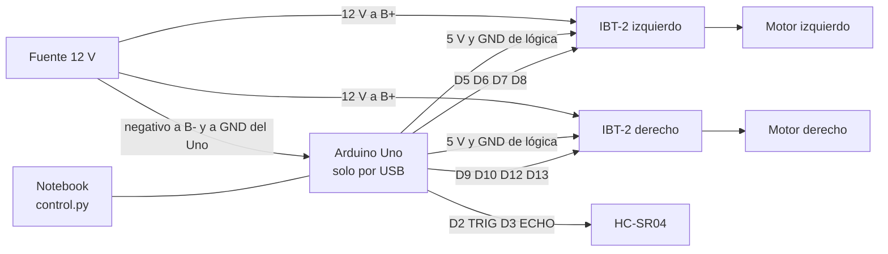

# Plataforma

Prototipo electrónico de banco para una futura plataforma vehicular de navegación intrasurco. La notebook manda la dirección y la velocidad por USB. El Arduino Uno mueve los dos motores juntos y, si el sensor mide un obstáculo a 20 cm o menos, frena el avance y los giros. La marcha atrás sigue habilitada.

No hay chasis ni ruedas. Las pruebas se hicieron con los motores sin carga. El desplazamiento y la navegación entre surcos no se evaluaron.

Materia: Electrónica Digital, 2026, UNNOBA.

El relato del trabajo está en los dos PDF del repo. Este archivo describe el mismo prototipo y cómo usar el código.

## Equipo

Alumnos:

- Felipe Jorge Lucero
- Dante Ismael Gómez
- Matías Nahuel Acuña
- Juanita Nervo
- Mateo Ezequiel Hernandez

Docentes: Adrián Jaszczyszyn y Marcelo Guiguet.

## Qué hay en el repo

| Archivo | Rol |
| --- | --- |
| `plataforma/plataforma.ino` | Sketch que quedó cargado en el Arduino |
| `control.py` | Ventana de control en la notebook |
| `requirements.txt` | Dependencia de Python (`pyserial`) |
| `InformeED_Plataforma_Intrasurco.pdf` | Informe técnico del proyecto |
| `PresentaciónED_Plataforma_Intrasurco.pdf` | Presentación del proyecto |

La ventana se llama **Control de la Plataforma**.

## Cómo usarlo

La programación se hizo en Visual Studio Code con PlatformIO. El sketch del repo es `plataforma/plataforma.ino`.

1. Cargarlo en el Arduino Uno (PlatformIO, IDE o `arduino-cli`), placa `arduino:avr:uno`, 9600 baudios. En esta máquina el puerto fue **COM7**.
2. Cerrar el Serial Monitor. Un solo programa puede tener el puerto abierto. Si aparece `Acceso denegado`, el monitor o esta ventana ya lo están usando.
3. Instalar la dependencia y abrir el control:

```bash
pip install -r requirements.txt
python control.py
```

4. Pulsar **CONECTAR**. Al abrir el puerto el Uno se reinicia: el programa espera 2 segundos y después empieza a mandar comandos.
5. Mantener la flecha o el botón para mover. Soltar para parar. La barra de velocidad va de 0 a 100 y arranca en 100.

| Tecla | Movimiento |
| --- | --- |
| ↑ o W | Adelante |
| ↓ o S | Atrás |
| ← o A | Izquierda |
| → o D | Derecha |
| Espacio | Parar |

Si la ventana pierde el foco, la plataforma se detiene.

## Comportamiento

Los dos motores reciben la misma magnitud. Una rampa sube o baja de a 10 unidades de PWM cada 20 ms, con un tope de **150**. Ese tope es la limitación de potencia del programa: el porcentaje 0–100 de la ventana se mapea a PWM 0–150. Con esa limitación, en el último ensayo se midió una corriente máxima de unos **10 A**.

La fuente inicial fue una Pronext de **12 V y 2 A**. Con un solo motor el giro era casi continuo. Con los dos, el movimiento era intermitente a cualquier velocidad. Después se usó otra fuente de 12 V, de corriente nominal no documentada. Con esa fuente los dos motores funcionaron juntos, sin carga. En esas pruebas la alimentación dejó de ser el límite. Falta dimensionarla para cuando los motores trabajen con carga.

Antes de invertir el giro de un motor hay una pausa de 200 ms.

Si pasan más de 400 ms sin un comando nuevo, el Arduino para los motores.

El HC-SR04 mide cada 100 ms. Las mediciones se contrastaron con una regla a distancias cortas y medias.

- Eco real a **20 cm o menos**: se bloquean adelante y los giros. Atrás sigue. La ventana bloquea esas órdenes.
- Sin eco, o distancia mayor a 20 cm: el frente se toma como libre y se puede avanzar. El sensor, cuando no hay nada adelante, muchas veces no devuelve eco. Eso no es un obstáculo.

Esa respuesta está en el programa. No se probó con el prototipo en movimiento, porque no hay chasis ni ruedas.

La ventana muestra la distancia en cm y la velocidad de acercamiento en cm/s (positiva cuando el objeto se acerca).

## Protocolo serial

9600 baudios, una línea por mensaje.

La notebook manda, cada 100 ms:

```text
F,100
B,80
L,60
R,60
S,0
```

`F` adelante, `B` atrás, `L` izquierda, `R` derecha, `S` parar. El número es el porcentaje 0–100. El Arduino lo mapea a PWM 0–150.

El Arduino responde:

```text
DIST,18.4,1
DIST,-1.0,0
```

El segundo campo es la distancia en cm. `-1.0` significa que no hubo eco. El tercero vale `1` solo cuando hay un eco real a 20 cm o menos.

## Conexiones

Hay dos drivers IBT-2 (BTS7960), uno por motor. Los motores no van en paralelo sobre un mismo driver. Son motorreductores de 6 V o 12 V, del tipo usado en vehículos eléctricos infantiles, alimentados a 12 V.

Los drivers L298N de la placa original de cátedra se descartaron sin probarlos. Su capacidad es del orden de 2 A por canal. Por consultas se estimaron picos de 15 a 20 A en estos motores. Esa cifra es orientativa: no es una medición ni un dato del fabricante.



### Alimentación

| Qué | Dónde |
| --- | --- |
| Arduino | Solo USB de la notebook. No usar el plug de barril con la fuente de motores. |
| Lógica de los dos IBT-2 y del sensor | `VCC` a 5 V del Arduino y `GND` a GND del Arduino. Puede ir por los rieles de la protoboard. Si el riel está cortado al medio, hace falta un puente. |
| Motores | 12 V de la fuente a **B+** de los dos drivers. Negativo de la fuente a **B−** de los dos drivers. |
| GND común | El negativo de la fuente (B−) se une al GND del Arduino. Sin ese cable la lógica y la potencia no comparten referencia. |

La protoboard reparte las conexiones lógicas. El montaje es experimental. En una implementación definitiva, la corriente de los motores tiene que ir por cables de potencia dimensionados, no por las pistas de la protoboard. Los 12 V no se conectan al pin de 5 V del Arduino.

La fuente que quedó en uso es de 12 V. La inicial, de 12 V y 2 A, no sostuvo los dos motores a la vez. La corriente nominal de la fuente nueva no quedó documentada. Bajo carga todavía hay que verificarla.

### Driver izquierdo

| IBT-2 | Arduino |
| --- | --- |
| RPWM | D5 |
| LPWM | D6 |
| R_EN | D7 |
| L_EN | D8 |
| VCC | 5 V |
| GND | GND |
| B+ | 12 V de la fuente |
| B− | Negativo de la fuente |
| M+ / M− | Motor izquierdo |

### Driver derecho

| IBT-2 | Arduino |
| --- | --- |
| RPWM | D9 |
| LPWM | D10 |
| R_EN | D12 |
| L_EN | D13 |
| VCC | 5 V |
| GND | GND |
| B+ | 12 V de la fuente |
| B− | Negativo de la fuente |
| M+ / M− | Motor derecho |

D13 es el LED de la placa. Queda encendido porque L_EN del driver derecho se mantiene en HIGH.

D11 no va a un cable en el armado final, pero el sketch lo deja en HIGH. Sirve por si un enable del segundo driver quedó en ese pin.

R_IS y L_IS de los dos drivers no se usan. A0 y A1 quedan libres.

### Sensor HC-SR04

| Sensor | Arduino |
| --- | --- |
| VCC | 5 V |
| GND | GND |
| TRIG | D2 |
| ECHO | D3 |

## Notas de la lógica

- Los pines 5 y 6 usan el Timer0 (cerca de 976 Hz). Los pines 9 y 10 usan el Timer1 (cerca de 490 Hz). No se cambia el Timer0, porque de ahí salen `millis()` y la comunicación.
- El PWM solo se escribe cuando el valor cambia. Reescribir cero y el valor en cada vuelta hacía el movimiento débil y cortado.
- `INVERTIR_IZQ` e `INVERTIR_DER` están en `false`. Si un motor gira al revés, se cambia ese flag en el sketch, no el cableado de potencia.
- El potenciómetro de 5 kΩ se usó solo en las pruebas iniciales de velocidad. No forma parte del mando actual: el control es la ventana de la notebook.
- Las pruebas de movimiento se hicieron con los motores sin montar. No se verificó desplazamiento ni trayectoria.
